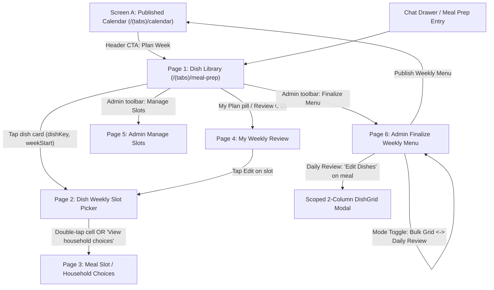

# Contract: Mobile UI Screens & Reusable Components

**Feature**: `002-household-meal-planner` | **Date**: 2026-11-07

## 1. Navigation & Screen Inventory



| Screen | File | Access | Primary Responsibility |
|---|---|---|---|
| **A. Published Calendar** | `mobile/app/features/calendar/screens/CalendarScreen.tsx` | All members | Read-only Sunday–Saturday header (`WeekStrip`), horizontal day swipe, 4 stacked meal sections (`Breakfast`, `Lunch`, `Snacks`, `Dinner`), 2-column dish grid. Shows `"Menu not finalized"` when unpublished; tapping a dish opens details. |
| **Page 1. Dish Library** | `mobile/app/features/mealPrep/screens/DishLibraryScreen.tsx` | All members | Displays planning week (`Plan for MMM D–D`), search bar, `+ Add new dish`, 3 filter tabs (`Liked`, `Recently Added`, `Suggested`) over one dish catalog, 2-column `DishGrid`, and quick navigation to `My Weekly Review` (plus `Manage Slots` and `Finalize Menu` for admin). |
| **Page 2. Dish Weekly Slot Picker** | `mobile/app/features/mealPrep/screens/DishWeeklyPickerScreen.tsx` | All members | Movie-ticket-booking 7 × 4 `WeeklySlotGrid` (`mode="dish-selection"`). Single-tap local selection, 1-slot contextual Add or multi-slot `"Add <dish> to N slots"`, double-tap + accessible `"View household choices"` button to open Page 3. |
| **Page 3. Meal Slot Details** | `mobile/app/features/mealPrep/screens/MealSlotDetailsScreen.tsx` | All members | Displays complete meal bundles (`MealProposalCard`) for `(date, meal)` grouped by proposer, with `"I'll eat this meal"` and `"Keep my own meal"` actions (or read-only fixed menu if `reserved`). |
| **Page 4. My Weekly Review** | `mobile/app/features/mealPrep/screens/MyWeeklyReviewScreen.tsx` | All members | Lists the member's weekly selections by day and meal, shows `SubmissionDeadline` and status (`Draft` / `Submitted` / `Locked`), `Edit` actions per slot, and `"Submit Weekly Meal Plan"` CTA. |
| **Page 5. Admin Manage Slots** | `mobile/app/features/mealPrep/screens/ManageSlotsScreen.tsx` | Admin only | Uses `WeeklySlotGrid` (`mode="slot-management"`) with `Available` vs `Reserved` toggle, multi-slot selection, confirmation dialog when reserving slots with member selections, and atomic `"Save Slot Availability"`. |
| **Page 6. Admin Finalize Weekly Menu** | `mobile/app/features/mealPrep/screens/FinalizeWeeklyMenuScreen.tsx` | Admin only | Single screen with `Bulk Grid` (`WeeklySlotGrid` `mode="bulk-finalization"` + `MealSourceSelector` + `BulkActionBar`) and `Daily Review` (`DailyReviewCarousel` + `DailyMealCard` + scoped `DishGrid` modal) over the same draft, plus `"Publish Weekly Menu"`. |

---

## 2. Core Reusable Component Contracts

### 2.1 `WeeklySlotGrid` (`mobile/app/features/mealPrep/components/WeeklySlotGrid.tsx`)
The single 7 (Sun–Sat rows) × 4 (`Breakfast`, `Lunch`, `Snack`, `Dinner` columns) matrix component used across Pages 2, 5, and 6.

```ts
export type WeeklySlotGridMode = 'dish-selection' | 'slot-management' | 'bulk-finalization';

export interface SlotCoord {
  date: string; // YYYY-MM-DD (Sun..Sat)
  meal: MealCategory; // 'breakfast' | 'lunch' | 'snacks' | 'dinner'
}

export interface WeeklySlotGridProps {
  mode: WeeklySlotGridMode;
  weekStart: string;
  slots: Record<string, PlannerSlotViewModel>; // keyed by `${date}:${meal}`
  members: HouseholdMember[];
  myId: string;
  selectedSlots: SlotCoord[];
  focusedSlot?: SlotCoord | null;
  disabled?: boolean;
  /** Mode: 'dish-selection' — dish key being scheduled, to highlight slots where user already added it */
  activeDishKey?: string;
  /** Single-tap handler (deferred by 220ms in 'dish-selection' mode to coordinate with double-tap) */
  onToggleSlot: (slot: SlotCoord) => void;
  /** Double-tap or accessible button handler to inspect household proposals for a slot */
  onInspectSlot?: (slot: SlotCoord) => void;
  /** Contextual 1-slot immediate add handler in 'dish-selection' mode */
  onConfirmSingleSlot?: (slot: SlotCoord) => void;
}
```

**Accessibility & Gesture Requirements**:
- Minimum cell touch target: `>= 48dp` height.
- In `dish-selection` mode:
  - Single-tap is buffered via a `220ms` timer so a double-tap opens `onInspectSlot` without mutating `selectedSlots`.
  - Whenever a cell is selected or focused (or via an explicit `"View household choices"` bar below the grid), users can open Page 3 with a single tap—never relying solely on double-tap.
  - Reserved cells render a lock icon (`Lock` from `lucide-react-native`), `"Reserved"` label, and in `dish-selection` mode allow inspection (`onInspectSlot`) while blocking selection for non-admins.

### 2.2 `DishGrid` & `CatalogDishCard` (`mobile/app/features/mealPrep/components/DishGrid.tsx`, `CatalogDishCard.tsx`)
- Two-column (`FlashList` or `FlatList` with `numColumns={2}`) photo card grid used in Page 1 (Dish Library) and Page 6 Mode B ("Edit Dishes" sheet).
- Displays dish thumbnail (`expo-image`), title (`numberOfLines={2}`), compact `ContributorAvatarStack` + `"N members interested"`, and optional `"Requested"` badge in admin Daily Review mode.

### 2.3 `MealProposalCard` (`mobile/app/features/mealPrep/components/MealProposalCard.tsx`)
- Displays one member's complete meal bundle on Page 3 (`MealSlotDetailsScreen`).
- Props: `proposal`, `proposer`, `joinedMembers`, `isMyActiveChoice`, `isOwnProposal`, `isSlotReserved`, `isLocked`, `onJoinProposal`, `onKeepOwnMeal`.
- Renders constituent dish chips/thumbnails (`Rice • Tomato Dal • Sambar • Curd`), participant avatar stack, and primary CTA (`"I'll eat this meal"` / `"Joined"` / `"Keep my own meal"`).
