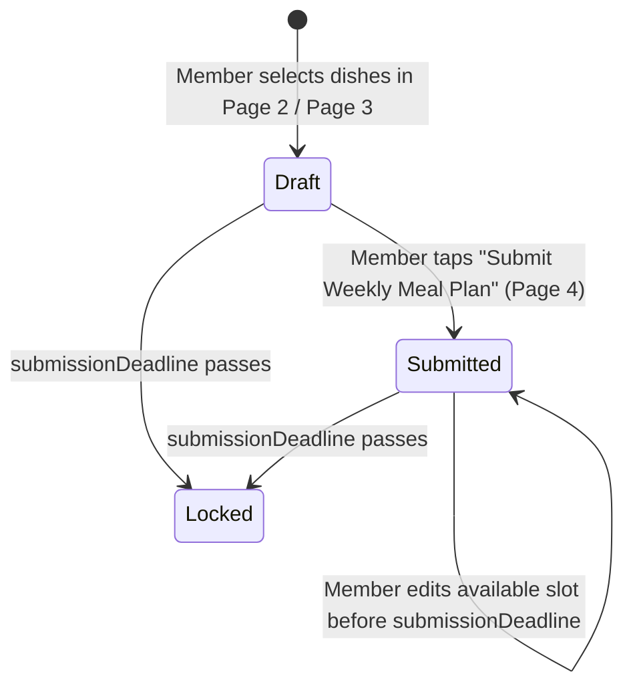
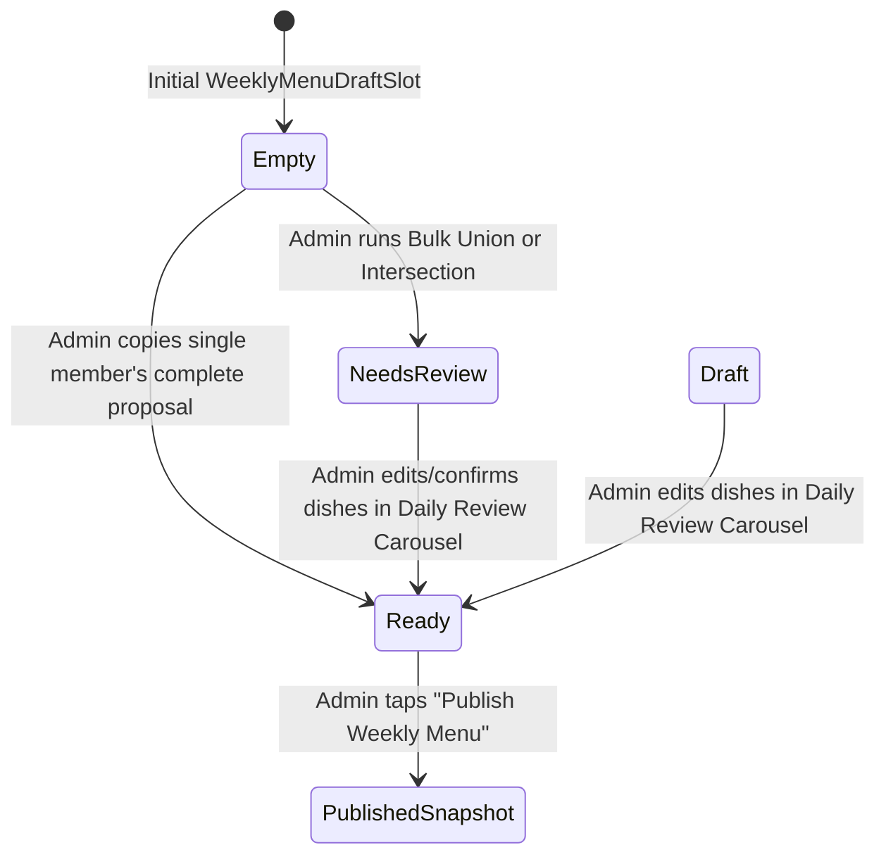

# Data Model: Household Meal Planner

**Feature**: `002-household-meal-planner` | **Date**: 2026-11-07

## 1. Domain Overview

The Household Meal Planner separates four distinct data layers per household and planning week (`weekStart`, always a Sunday `YYYY-MM-DD`):

1. **Unified Dish Catalog**: Shared & user-owned `Recipe` rows, imported/saved `Bookmark` rows (`awaitingContent = false`), and household dish history exposed as a normalized `CatalogDish` view.
2. **Slot Policies & Deadlines (`WeeklyPlan`, `MealSlotPolicy`)**: Admin-configured weekly submission cutoff (`submissionDeadline`) and per-slot availability (`available` | `reserved`).
3. **Member Proposals & Submissions (`MealProposal`, `MealProposalDish`, `MemberSlotChoice`, `MemberWeeklySubmission`)**: Complete multi-dish meal combinations proposed by members for a `(householdId, date, meal)` slot, who joined which proposal, and whether each member has submitted their weekly plan.
4. **Admin Working Draft vs Published Menu (`WeeklyMenuDraftSlot`, `WeeklyMenuDraftDish` vs `PlannedDish` / `MealDay`)**: The admin's editable weekly draft (mutated by Bulk Grid and Daily Review Carousel) vs the versioned published snapshot read by the Calendar and Shopping List.

---

## 2. Prisma Schema Additions & Updates (`api/prisma/schema.prisma`)

### Enums

```prisma
enum SlotPolicyStatus {
  available
  reserved
}

enum SubmissionStatus {
  draft
  submitted
  locked
}

enum DraftSlotStatus {
  empty
  draft
  needs_review
  ready
}
```

### Models

#### `WeeklyPlan`
Tracks the household's planning lifecycle for a 7-day Sunday–Saturday week.

| Field | Type | Constraints / Default | Description |
|---|---|---|---|
| `householdId` | `String (Uuid)` | PK (composite), FK → `Household.id` | Owning household |
| `weekStart` | `DateTime (Date)` | PK (composite) | Sunday date (`YYYY-MM-DD`) |
| `submissionDeadline` | `DateTime? (Timestamptz)` | Nullable | Cutoff after which member submissions lock |
| `publishedVersion` | `Int` | `@default(0)` | `0` = unpublished; incremented on each publish |
| `publishedAt` | `DateTime? (Timestamptz)` | Nullable | Timestamp of latest publication |
| `hasUnpublishedChanges` | `Boolean` | `@default(false)` | `true` when admin edits draft after publishing |
| `createdAt` | `DateTime` | `@default(now())` | Creation timestamp |
| `updatedAt` | `DateTime` | `@updatedAt` | Update timestamp |

#### `MealSlotPolicy`
Controls whether members can propose/edit meals in a specific `(householdId, date, meal)` slot (Page 5 — Admin Manage Slots).

| Field | Type | Constraints / Default | Description |
|---|---|---|---|
| `householdId` | `String (Uuid)` | PK (composite), FK → `Household.id` | Owning household |
| `date` | `DateTime (Date)` | PK (composite) | Slot calendar date (`YYYY-MM-DD`) |
| `meal` | `MealType` | PK (composite) | `breakfast` \| `lunch` \| `snacks` \| `dinner` |
| `status` | `SlotPolicyStatus` | `@default(available)` | `available` or `reserved` |
| `updatedById` | `String? (Uuid)` | FK → `User.id` | Admin who last changed policy |
| `updatedAt` | `DateTime` | `@updatedAt` | Last change timestamp |

#### `MealProposal` & `MealProposalDish`
Represents one member's complete meal bundle for a slot (e.g., Rahul's Wednesday Lunch: `Rice • Tomato Dal • Sambar • Curd`). Each member has at most one authored proposal per `(householdId, date, meal)`.

| Model | Field | Type | Constraints / Description |
|---|---|---|---|
| `MealProposal` | `id` | `String (Uuid)` | PK |
| `MealProposal` | `householdId` | `String (Uuid)` | FK → `Household.id` |
| `MealProposal` | `date` | `DateTime (Date)` | Slot date (`YYYY-MM-DD`) |
| `MealProposal` | `meal` | `MealType` | `breakfast` \| `lunch` \| `snacks` \| `dinner` |
| `MealProposal` | `proposerId` | `String (Uuid)` | FK → `User.id`; `@@unique([householdId, date, meal, proposerId])` |
| `MealProposalDish` | `id` | `String (Uuid)` | PK |
| `MealProposalDish` | `proposalId` | `String (Uuid)` | FK → `MealProposal.id` (`onDelete: Cascade`) |
| `MealProposalDish` | `position` | `Int` | Display order within the bundle |
| `MealProposalDish` | `dishKey` | `String` | Stable catalog identifier (`recipe:<id>`, `bookmark:<id>`, `dish:<id>`, or `custom:<slug>`) |
| `MealProposalDish` | `name` | `String (VarChar 150)` | Snapshot of dish title |
| `MealProposalDish` | `imageUrl` | `String?` | Snapshot of dish image |
| `MealProposalDish` | `recipeId` | `String? (Uuid)` | Optional FK → `Recipe.id` |
| `MealProposalDish` | `bookmarkId` | `String? (Uuid)` | Optional FK → `Bookmark.id` |
| `MealProposalDish` | `prepMinutes` | `Int?` | Snapshot prep time |
| `MealProposalDish` | `cookMinutes` | `Int?` | Snapshot cook time |
| `MealProposalDish` | `baseServings` | `Int?` | Snapshot servings |
| `MealProposalDish` | `ingredients` | `String[]` | Snapshot ingredients |
| `MealProposalDish` | `steps` | `String[]` | Snapshot steps |

#### `MemberSlotChoice`
Records which `MealProposal` a household member has chosen to eat for a slot (Page 3 `"I'll eat this meal"` or `"Keep my own meal"`).

| Field | Type | Constraints / Description |
|---|---|---|
| `householdId` | `String (Uuid)` | PK (composite), FK → `Household.id` |
| `date` | `DateTime (Date)` | PK (composite) |
| `meal` | `MealType` | PK (composite) |
| `userId` | `String (Uuid)` | PK (composite), FK → `User.id` |
| `proposalId` | `String (Uuid)` | FK → `MealProposal.id` (`onDelete: Cascade`) |
| `updatedAt` | `DateTime` | `@updatedAt` |

*Invariant*: `@@id([householdId, date, meal, userId])` guarantees **one active complete meal proposal per member per slot**. When a member adds a dish to their own bundle (Page 2) or taps `"Keep my own meal"` (Page 3), their `MemberSlotChoice.proposalId` points to their own `MealProposal`. When they tap `"I'll eat this meal"` on Member A's card, `MemberSlotChoice.proposalId` updates to Member A's `MealProposal` (while their own authored `MealProposal` row remains intact in case they switch back before deadline closure).

#### `MemberWeeklySubmission`
Tracks a member's weekly review and submission state (Page 4 — My Weekly Review).

| Field | Type | Constraints / Description |
|---|---|---|
| `householdId` | `String (Uuid)` | PK (composite), FK → `Household.id` |
| `weekStart` | `DateTime (Date)` | PK (composite), Sunday `YYYY-MM-DD` |
| `userId` | `String (Uuid)` | PK (composite), FK → `User.id` |
| `status` | `SubmissionStatus` | `@default(draft)` (`draft` \| `submitted` \| `locked`) |
| `submittedAt` | `DateTime? (Timestamptz)` | Set when member taps `"Submit Weekly Meal Plan"` |
| `updatedAt` | `DateTime` | `@updatedAt` |

#### `WeeklyMenuDraftSlot` & `WeeklyMenuDraftDish`
Stores the admin's unpublished working menu for Page 6 (shared by Mode A Bulk Grid and Mode B Daily Review Carousel).

| Model | Field | Type | Constraints / Description |
|---|---|---|---|
| `WeeklyMenuDraftSlot` | `householdId` | `String (Uuid)` | PK (composite), FK → `Household.id` |
| `WeeklyMenuDraftSlot` | `date` | `DateTime (Date)` | PK (composite) |
| `WeeklyMenuDraftSlot` | `meal` | `MealType` | PK (composite) |
| `WeeklyMenuDraftSlot` | `status` | `DraftSlotStatus` | `@default(empty)` (`empty` \| `draft` \| `needs_review` \| `ready`) |
| `WeeklyMenuDraftSlot` | `sourceNote` | `String?` | E.g., `"Rahul's meal"`, `"Combined (2 members)"`, `"Common dishes"` |
| `WeeklyMenuDraftDish` | `id` | `String (Uuid)` | PK |
| `WeeklyMenuDraftDish` | `householdId` | `String (Uuid)` | FK → `WeeklyMenuDraftSlot` |
| `WeeklyMenuDraftDish` | `date` | `DateTime (Date)` | FK → `WeeklyMenuDraftSlot` |
| `WeeklyMenuDraftDish` | `meal` | `MealType` | FK → `WeeklyMenuDraftSlot` |
| `WeeklyMenuDraftDish` | `position` | `Int` | Order within slot |
| `WeeklyMenuDraftDish` | `dishKey` | `String` | Catalog dish key |
| `WeeklyMenuDraftDish` | `name` | `String (VarChar 150)` | Dish title |
| `WeeklyMenuDraftDish` | `imageUrl` | `String?` | Dish image |
| `WeeklyMenuDraftDish` | `recipeId` | `String? (Uuid)` | Optional FK → `Recipe.id` |
| `WeeklyMenuDraftDish` | `bookmarkId` | `String? (Uuid)` | Optional FK → `Bookmark.id` |
| `WeeklyMenuDraftDish` | `prepMinutes` | `Int?` | Prep time |
| `WeeklyMenuDraftDish` | `cookMinutes` | `Int?` | Cook time |
| `WeeklyMenuDraftDish` | `baseServings` | `Int?` | Base servings |
| `WeeklyMenuDraftDish` | `ingredients` | `String[]` | Ingredients |
| `WeeklyMenuDraftDish` | `steps` | `String[]` | Steps |

#### Published Menu Representation (`MealDay` & `PlannedDish`)
When the admin executes **Publish Weekly Menu** (`POST /meal-planner/weeks/:weekStart/publish`):
- Within a single database transaction:
  1. `WeeklyPlan.publishedVersion` is incremented, `publishedAt = now()`, and `hasUnpublishedChanges = false`.
  2. For all 7 days of `weekStart`, `MealDay` rows are upserted with `status = 'fixed'` (representing published days).
  3. Existing `PlannedDish` rows for that week are replaced with the snapshot from `WeeklyMenuDraftDish` (`status = 'approved'`, `isSuggestion = false`), and `MealResponse` rows are populated from `MemberSlotChoice` participants (or all household members for admin-assigned slots) so that `GET /calendar` (Published Calendar) and `GET /meal-prep` (cooking prep & shopping list) immediately reflect the published snapshot.
  4. Subsequent edits to `WeeklyMenuDraftSlot` set `WeeklyPlan.hasUnpublishedChanges = true` and **never touch** `MealDay` or `PlannedDish` until the admin publishes again.

---

## 3. State Transitions & Server-Enforced Invariants





### Validation & Authorization Rules

1. **Household Isolation**: Every query and mutation resolves `householdId` from the authenticated user's `HouseholdMember` record (`requireMembership(userId)`), never from client-supplied household IDs.
2. **Slot Policy Guard**: Regular members (`role === 'member'`) attempting to add/remove dishes or switch proposals on a slot where `MealSlotPolicy.status === 'reserved'` receive `409 Conflict ("This meal slot is reserved by the admin")`.
3. **Deadline Guard**: Regular members attempting to mutate proposals, slot choices, or submissions when `WeeklyPlan.submissionDeadline <= now()` (or `MemberWeeklySubmission.status === 'locked'`) receive `409 Conflict ("The planning deadline for this week has passed")`.
4. **Admin Role Guard**: `PUT /meal-planner/weeks/:weekStart/slot-policies`, `POST /meal-planner/weeks/:weekStart/bulk-assign`, `PUT /meal-planner/slots/:date/:meal/draft`, and `POST /meal-planner/weeks/:weekStart/publish` require `membership.role === 'admin'` (`requireAdmin(membership)`).
5. **History Preservation on Slot Reservation**: Changing a slot from `available` to `reserved` in Page 5 updates `MealSlotPolicy.status` without deleting `MealProposal` or `MemberSlotChoice` rows.
