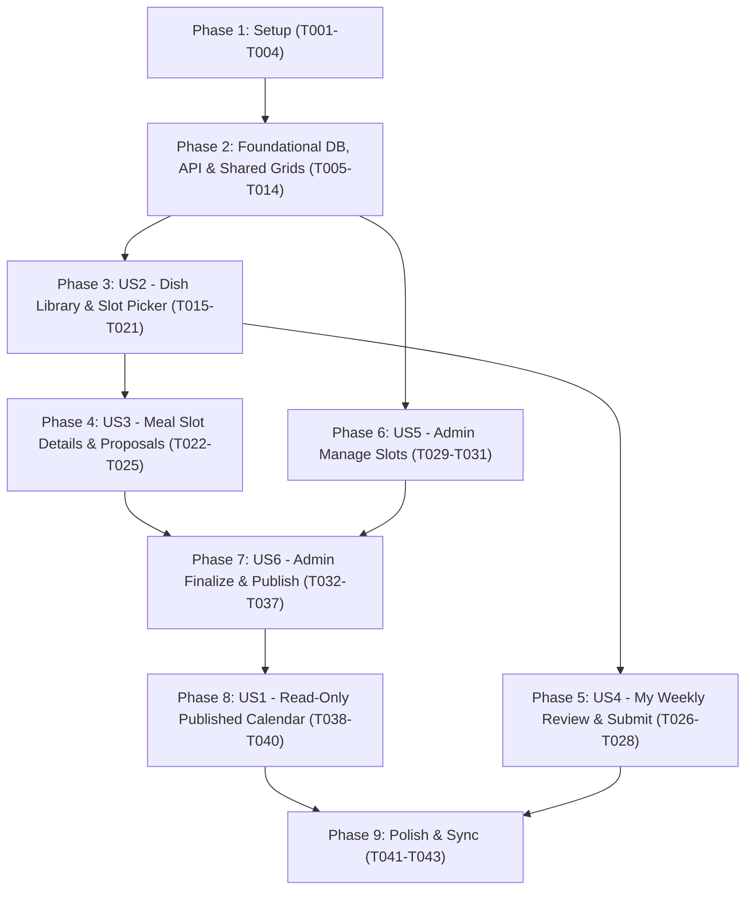

# Tasks: Household Meal Planner

**Input**: Design documents from `/specs/002-household-meal-planner/` (`plan.md`, `spec.md`, `research.md`, `data-model.md`, `contracts/api.md`, `contracts/mobile-ui.md`, `quickstart.md`)

**Prerequisites**: `plan.md` (required), `spec.md` (required for user stories), `research.md`, `data-model.md`, `contracts/`

**Tests**: Not included as mandatory tasks per project instructions ("Do not run automated tests or Playwright unless explicitly requested").

**Organization**: Tasks are grouped into Setup, Foundational (Prisma schema, base API wiring, shared mobile types/utils/grid primitives), and User Story phases (`[US1]` through `[US6]`) to enable incremental, verifiable delivery.

## Format: `[ID] [P?] [Story] Description`

- **[P]**: Can run in parallel (different files, no dependencies on incomplete tasks)
- **[Story]**: User story label (`[US1]`..`[US6]`) — included on User Story phase tasks only
- Exact file paths and verbatim `data-model.md` constraints are included in each task description

---

## Phase 1: Setup (Shared Infrastructure & Reuse Wiring)

**Purpose**: Prepare shared types, utility helpers, and re-exported primitives across `mobile/app/features/calendar/` and `mobile/app/features/mealPrep/`.

- [X] T001 Define TypeScript interfaces and enums (`SlotPolicyStatus`: `'available' | 'reserved'`, `SubmissionStatus`: `'draft' | 'submitted' | 'locked'`, `DraftSlotStatus`: `'empty' | 'draft' | 'needs_review' | 'ready'`, `WeeklySlotGridMode`: `'dish-selection' | 'slot-management' | 'bulk-finalization'`, `CatalogDish`, `MealProposal`, `PlannerSlotViewModel`, `SlotCoord`) in `mobile/app/features/mealPrep/types/mealPlanner.types.ts`
- [X] T002 [P] Implement pure planner utilities (Sunday `weekStart` calculation, 28-slot `YYYY-MM-DD:meal` coordinate key helpers, 220ms double-tap gesture timer helper, and client-side union/intersection preview calculators) in `mobile/app/features/mealPrep/utils/mealPlanner.utils.ts`
- [X] T003 [P] Create `HouseholdAvatarStack` wrapper re-exporting `ContributorAvatarStack` from `mobile/app/features/calendar/components/ContributorAvatarStack.tsx` with meal-planner default props in `mobile/app/features/mealPrep/components/HouseholdAvatarStack.tsx`
- [X] T004 [P] Create reusable `MealSlotStatus` badge component rendering slot policy (`available` | `reserved`) and draft states (`empty` | `draft` | `needs_review` | `ready`) with lock icon support in `mobile/app/features/mealPrep/components/MealSlotStatus.tsx`

---

## Phase 2: Foundational (Database Schema, Base API Module & Core Shared Grid Components)

**Purpose**: Core database models, API routing/validation scaffolding, and the two foundational shared UI primitives (`DishGrid` and 7 × 4 `WeeklySlotGrid`) that power multiple user stories.

**⚠️ CRITICAL**: Complete this phase before starting User Story phases.

- [X] T005 Add enums (`SlotPolicyStatus { available reserved }`, `SubmissionStatus { draft submitted locked }`, `DraftSlotStatus { empty draft needs_review ready }`) and models (`WeeklyPlan` with composite PK `[householdId, weekStart]`, `submissionDeadline DateTime?`, `publishedVersion Int @default(0)`, `publishedAt DateTime?`, `hasUnpublishedChanges Boolean @default(false)`; `MealSlotPolicy` with composite PK `[householdId, date, meal]` and `status SlotPolicyStatus @default(available)`; `MealProposal` with `@@unique([householdId, date, meal, proposerId])`; `MealProposalDish` with `name String @db.VarChar(150)`, `position Int`, `dishKey String`; `MemberSlotChoice` with composite PK `@@id([householdId, date, meal, userId])`; `MemberWeeklySubmission` with composite PK `[householdId, weekStart, userId]` and `status SubmissionStatus @default(draft)`; `WeeklyMenuDraftSlot` with composite PK `[householdId, date, meal]` and `status DraftSlotStatus @default(empty)`; `WeeklyMenuDraftDish` with `name String @db.VarChar(150)`) in `api/prisma/schema.prisma`
- [X] T006 Generate Prisma migration and regenerate Prisma client in `api/prisma/migrations/` and `api/src/generated/prisma/`
- [X] T007 [P] Create Zod request/query/param validation schemas (`weekStart` Sunday `YYYY-MM-DD`, `dateKeySchema`, `meal` enum `'breakfast' | 'lunch' | 'dinner' | 'snacks'`, dish filter `'liked' | 'recently_added' | 'suggested'`, multi-slot dish selection body, proposal choice body, slot policies body, bulk-assign body, draft slot body, and publish body) in `api/src/modules/mealPlanner/schema.ts`
- [X] T008 Implement base Prisma repository queries and transaction helpers for `WeeklyPlan`, `MealSlotPolicy`, `MealProposal`, `MemberSlotChoice`, `MemberWeeklySubmission`, and `WeeklyMenuDraftSlot` in `api/src/modules/mealPlanner/repository.ts`
- [X] T009 Implement core guard helpers (`requireMembership(userId)` household isolation, `requireAdmin(membership)` role guard, slot policy guard rejecting non-admin edits when `MealSlotPolicy.status === 'reserved'` with `409 Conflict`, and deadline guard rejecting non-admin edits when `WeeklyPlan.submissionDeadline <= now()` or `MemberWeeklySubmission.status === 'locked'` with `409 Conflict`) and `GET /meal-planner/weeks/:weekStart` state assembly in `api/src/modules/mealPlanner/service.ts`
- [X] T010 Create Express controller handlers and router for `/meal-planner` in `api/src/modules/mealPlanner/controller.ts` and `api/src/modules/mealPlanner/routes.ts`, and mount `/meal-planner` in `api/src/app.ts`
- [X] T011 [P] Implement typed HTTP client methods (`getCatalogDishes`, `getWeekPlan`, `saveDishSelections`, `setSlotChoice`, `submitWeeklyPlan`, `updateSlotPolicies`, `bulkAssignDraft`, `updateSlotDraft`, `publishWeeklyMenu`) in `mobile/app/features/mealPrep/services/mealPlanner.api.ts`
- [X] T012 Implement Zustand store (`mealPlannerStore`) holding active `weekStart`, weekly slot map, catalog dishes, buffered `selectedSlots` keyed by `(weekStart, dishKey)`, and admin draft state in `mobile/app/features/mealPrep/store/mealPlannerStore.ts`
- [X] T013 [P] Build reusable `CatalogDishCard` and two-column `DishGrid` component (displaying dish thumbnail, title, `HouseholdAvatarStack`, `"N members interested"`, and optional `"Requested"` badge) in `mobile/app/features/mealPrep/components/CatalogDishCard.tsx` and `mobile/app/features/mealPrep/components/DishGrid.tsx`
- [X] T014 Build the single shared 7 (Sun–Sat) × 4 (`Breakfast`, `Lunch`, `Snack`, `Dinner`) `WeeklySlotGrid` component supporting `mode: 'dish-selection' | 'slot-management' | 'bulk-finalization'`, `>= 48dp` touch targets, lock icons for `reserved` slots, `220ms` deferred single-tap vs double-tap coordination, and an explicit accessible `"View household choices"` action bar in `mobile/app/features/mealPrep/components/WeeklySlotGrid.tsx`

**Checkpoint**: Database schema, `/meal-planner` API foundation, and the shared `DishGrid` + `WeeklySlotGrid` primitives are ready.

---

## Phase 3: User Story 2 - Browse Dish Library & Multi-Select Weekly Slots (Priority: P1) 🎯 MVP Increment 1

**Goal**: Enable household members and admins to browse/search/filter the unified dish catalog in a two-column photo grid (Page 1) and book a dish across multiple meal slots in the 7 × 4 grid (Page 2) without mutating backend state on single-tap highlight.

**Independent Test**: Open Meal Prep → Dish Library (`Page 1`), filter by `Liked` / `Recently Added` / `Suggested`, search for a dish, tap it to open `DishWeeklyPickerScreen` (`Page 2`), single-tap two available slots in `WeeklySlotGrid`, verify zero network requests fire until tapping `"Add to 2 slots"`, and verify reserved slots cannot be edited by regular members.

### Implementation for User Story 2

- [X] T015 [US2] Implement `getCatalogDishes(userId, weekStart, filter, query)` (deduplicating `Recipe`, ready `Bookmark` with `awaitingContent: false`, and household eaten dishes while computing `interestedMemberIds` for `weekStart`) and `saveDishSelections(userId, weekStart, input)` (atomic multi-slot upsert into caller's `MealProposal` + `MemberSlotChoice` enforcing `reserved` slot and `submissionDeadline` guards) in `api/src/modules/mealPlanner/service.ts` and `api/src/modules/mealPlanner/repository.ts`
- [X] T016 [US2] Wire `GET /meal-planner/dishes` and `POST /meal-planner/weeks/:weekStart/dish-selections` endpoints in `api/src/modules/mealPlanner/controller.ts` and `api/src/modules/mealPlanner/routes.ts`
- [X] T017 [P] [US2] Implement `useMealPlanner` hook (managing `weekStart` navigation, catalog filter/search state, and sub-screen routing) in `mobile/app/features/mealPrep/hooks/useMealPlanner.ts`
- [X] T018 [P] [US2] Implement `useDishSelections` hook (managing local buffered slot selections per `(weekStart, dishKey)`, 1-slot contextual Add vs multi-slot `"Add to N slots"`, and existing dish edit/remove state) in `mobile/app/features/mealPrep/hooks/useDishSelections.ts`
- [X] T019 [US2] Implement Page 1 `DishLibraryScreen` (week header `Plan for MMM D–D`, search bar, `Liked` / `Recently Added` / `Suggested` filter chips over one unified catalog, two-column `DishGrid`, `+ Add new dish` action, and navigation to Page 2 / Page 4 / Admin tools) in `mobile/app/features/mealPrep/screens/DishLibraryScreen.tsx`
- [X] T020 [US2] Implement Page 2 `DishWeeklyPickerScreen` (rendering dish header, shared `WeeklySlotGrid` with `mode="dish-selection"`, contextual 1-slot Add button, bottom `"Add <dish> to N slots"` CTA, and accessible `"View household choices"` trigger) in `mobile/app/features/mealPrep/screens/DishWeeklyPickerScreen.tsx`
- [X] T021 [US2] Update `MealPrepScreen` to host the Meal Planner screen flow (`DishLibraryScreen` as primary entry with toggle/access to Cook & Shop prep view) in `mobile/app/features/mealPrep/screens/MealPrepScreen.tsx`

**Checkpoint**: Page 1 (Dish Library) and Page 2 (Dish Weekly Slot Picker) work end-to-end with buffered multi-slot booking.

---

## Phase 4: User Story 3 - Inspect Meal Slot & Join a Household Proposal (Priority: P2)

**Goal**: Allow members to open Page 3 (`MealSlotDetailsScreen`) from any slot in Page 2 (via double-tap or the accessible `"View household choices"` button), view complete multi-dish meal combinations grouped by proposer, and either tap `"I'll eat this meal"` (replacing their active choice for that slot) or `"Keep my own meal"`.

**Independent Test**: Propose a multi-dish meal on Wednesday Lunch as Member A, open Wednesday Lunch in Page 3 as Member B, tap `"I'll eat this meal"`, confirm replacement, and verify participant count and avatars update across Page 2 and Page 3 while unsaved selections on other slots in Page 2 remain preserved on back navigation.

### Implementation for User Story 3

- [X] T022 [US3] Implement `setSlotChoice(userId, date, meal, input)` in `api/src/modules/mealPlanner/service.ts` and `api/src/modules/mealPlanner/repository.ts` enforcing `@@id([householdId, date, meal, userId])` on `MemberSlotChoice` (replacing the caller's active choice when joining another member's `MealProposal` while preserving the caller's authored `MealProposal` in draft for `"use_own_meal"`) and wire `PUT /meal-planner/slots/:date/:meal/choice` in `api/src/modules/mealPlanner/controller.ts` and `api/src/modules/mealPlanner/routes.ts`
- [X] T023 [P] [US3] Build `MealProposalCard` component (displaying proposer avatar/name, constituent dish chips/thumbnails `Rice • Tomato Dal • Sambar • Curd`, `HouseholdAvatarStack`, `"N members joined"`, `"I'll eat this meal"` CTA, and read-only lock state when `reserved`) in `mobile/app/features/mealPrep/components/MealProposalCard.tsx`
- [X] T024 [P] [US3] Implement `useHouseholdProposals` hook (grouping slot proposals, handling replacement confirmation alert when switching proposals, and handling `"Keep my own meal"`) in `mobile/app/features/mealPrep/hooks/useHouseholdProposals.ts`
- [X] T025 [US3] Implement Page 3 `MealSlotDetailsScreen` (slot day/meal header, `MealSlotStatus` badge, list of `MealProposalCard` bundles, `"Keep my own meal"` action, and read-only admin fixed menu notice when slot policy is `reserved`) in `mobile/app/features/mealPrep/screens/MealSlotDetailsScreen.tsx`

**Checkpoint**: Page 3 (Meal Slot / Household Choices) is synchronized with Page 2 and enforces one active bundle per member per slot.

---

## Phase 5: User Story 4 - Review & Submit Weekly Plan Before Deadline (Priority: P2)

**Goal**: Provide Page 4 (`MyWeeklyReviewScreen`) where each member reviews their complete dish combinations across Sunday–Saturday, edits unreserved slots before the deadline, and submits their weekly plan (`Draft` → `Submitted` → `Locked` after cutoff).

**Independent Test**: Open `MyWeeklyReviewScreen`, verify chosen bundles are grouped by day and meal with `SubmissionDeadline` shown, tap `"Submit Weekly Meal Plan"`, verify status becomes `Submitted`, and verify edits are blocked with `409 Conflict` once `submissionDeadline` passes.

### Implementation for User Story 4

- [X] T026 [US4] Implement `submitWeeklyPlan(userId, weekStart)` (transitioning `MemberWeeklySubmission.status` from `draft` to `submitted` with `submittedAt = now()`, allowing empty slots, and auto-transitioning expired weeks to `locked`) in `api/src/modules/mealPlanner/service.ts` and wire `POST /meal-planner/weeks/:weekStart/submit` in `api/src/modules/mealPlanner/controller.ts` and `api/src/modules/mealPlanner/routes.ts`
- [X] T027 [P] [US4] Build `SubmissionDeadline` component (displaying formatted cutoff timestamp, countdown or closed banner, and submission status pill `Draft` / `Submitted` / `Locked`) in `mobile/app/features/mealPrep/components/SubmissionDeadline.tsx`
- [X] T028 [US4] Implement Page 4 `MyWeeklyReviewScreen` (day-by-day list of Breakfast, Lunch, Snack, Dinner bundles, per-slot `Edit` action returning to Page 2/Page 3 when editable, and `"Submit Weekly Meal Plan"` bottom CTA) in `mobile/app/features/mealPrep/screens/MyWeeklyReviewScreen.tsx`

**Checkpoint**: Members can review, edit, and submit their weekly meal plans before the cutoff deadline.

---

## Phase 6: User Story 5 - Admin Manage Slots (Priority: P2)

**Goal**: Allow the household admin to reserve or reopen meal slots across the 28-slot week in Page 5 (`ManageSlotsScreen`) using the shared `WeeklySlotGrid` (`mode="slot-management"`), confirming before affecting slots that already have member proposals and preserving member choices in history.

**Independent Test**: As admin, open `ManageSlotsScreen`, select Friday Dinner and Saturday Dinner, switch mode to `Reserved`, confirm the affected-proposals dialog, save atomically, and verify regular members see lock icons and cannot edit those slots while existing member proposals remain preserved.

### Implementation for User Story 5

- [X] T029 [US5] Implement admin-only `updateSlotPolicies(userId, weekStart, input)` in `api/src/modules/mealPlanner/service.ts` and `api/src/modules/mealPlanner/repository.ts` (enforcing `requireAdmin`, updating `MealSlotPolicy.status` and optional `WeeklyPlan.submissionDeadline` in a single transaction without deleting `MealProposal` or `MemberSlotChoice` rows or publishing the menu) and wire `PUT /meal-planner/weeks/:weekStart/slot-policies` in `api/src/modules/mealPlanner/controller.ts` and `api/src/modules/mealPlanner/routes.ts`
- [X] T030 [P] [US5] Implement `useWeeklySlots` hook (managing multi-slot selection in `slot-management` mode, computing `available` vs `reserved` counts, and detecting selected slots that already have member proposals for confirmation) in `mobile/app/features/mealPrep/hooks/useWeeklySlots.ts`
- [X] T031 [US5] Implement Page 5 `ManageSlotsScreen` (rendering `Available` / `Reserved` mode toggle, shared `WeeklySlotGrid` with `mode="slot-management"`, slot availability summary counter, confirmation alert when reserving populated slots, and `"Save Slot Availability"` CTA) in `mobile/app/features/mealPrep/screens/ManageSlotsScreen.tsx`

**Checkpoint**: Admin slot reservation and deadline management work atomically and synchronize across member screens.

---

## Phase 7: User Story 6 - Admin Finalize & Publish Weekly Menu (Priority: P1)

**Goal**: Provide Page 6 (`FinalizeWeeklyMenuScreen`) with a state-preserving toggle between **Mode A (Bulk Grid)** and **Mode B (Daily Review Carousel)** over the unpublished `WeeklyMenuDraftSlot` records, plus `"Publish Weekly Menu"` with incomplete-slot warnings.

**Independent Test**: In Bulk Grid mode, select multiple slots and preview/apply `"Use Member A's complete meals"`, `"Combine selected members' dishes"` (`union` → `needs_review`), and `"Find common dishes"` (`intersection` → `needs_review`). Toggle to Daily Review Carousel, edit a slot's dishes via the scoped two-column `DishGrid`, and tap `"Publish Weekly Menu"`.

### Implementation for User Story 6

- [X] T032 [US6] Implement admin-only `bulkAssignDraft(userId, weekStart, input)` (supporting `dryRun` preview and applying `member_complete` → `ready` on populated slots while leaving missing slots `empty`, `union` → `needs_review`, and `intersection` → `needs_review` with `sourceNote: "Common dishes"`), `updateSlotDraft(userId, date, meal, input)` (setting `WeeklyMenuDraftDish` rows and marking `WeeklyPlan.hasUnpublishedChanges = true`), and `publishWeeklyMenu(userId, weekStart, allowIncomplete)` (checking for `empty` or `needs_review` slots when `allowIncomplete !== true` and snapshotting `WeeklyMenuDraftDish` into `MealDay` / `PlannedDish` while incrementing `WeeklyPlan.publishedVersion`) in `api/src/modules/mealPlanner/service.ts` and `api/src/modules/mealPlanner/repository.ts`
- [X] T033 [US6] Wire `POST /meal-planner/weeks/:weekStart/bulk-assign`, `PUT /meal-planner/slots/:date/:meal/draft`, and `POST /meal-planner/weeks/:weekStart/publish` in `api/src/modules/mealPlanner/controller.ts` and `api/src/modules/mealPlanner/routes.ts`
- [X] T034 [P] [US6] Build `MealSourceSelector` (selecting member complete meals, union/combine, or intersection/common dishes) and `BulkActionBar` (showing selected slot count, preview metrics `populatedCount` / `emptyCount` / `needsReviewCount`, and confirm action) in `mobile/app/features/mealPrep/components/MealSourceSelector.tsx` and `mobile/app/features/mealPrep/components/BulkActionBar.tsx`
- [X] T035 [P] [US6] Build `DailyMealCard` (rendering Breakfast, Lunch, Snack, Dinner for one day with `MealSlotStatus` badges, empty/needs-review highlights, and `"Edit Dishes"` trigger) and `DailyReviewCarousel` (7-day horizontal swipeable review pass) in `mobile/app/features/mealPrep/components/DailyMealCard.tsx` and `mobile/app/features/mealPrep/components/DailyReviewCarousel.tsx`
- [X] T036 [US6] Implement `useAdminFinalization` hook (coordinating `Bulk Grid` ↔ `Daily Review` mode toggle over shared draft state, bulk preview/apply, scoped slot dish picker with requested household dishes shown first, and publish warning/override dialog) in `mobile/app/features/mealPrep/hooks/useAdminFinalization.ts`
- [X] T037 [US6] Implement Page 6 `FinalizeWeeklyMenuScreen` (combining `Bulk Grid` via `WeeklySlotGrid` `mode="bulk-finalization"`, `DailyReviewCarousel`, scoped two-column `DishGrid` edit modal, and `"Publish Weekly Menu"` CTA) in `mobile/app/features/mealPrep/screens/FinalizeWeeklyMenuScreen.tsx`

**Checkpoint**: Admin can bulk-assign, review day-by-day in the carousel, edit individual meals, and publish a versioned menu snapshot.

---

## Phase 8: User Story 1 - View Published Calendar (Priority: P1)

**Goal**: Make `/(tabs)/calendar` (`CalendarScreen`) a clean, read-only view of the admin-published weekly menu ("what are we eating today?"), displaying `"Menu not finalized"` when a week is unpublished and never leaking draft proposals or unpublished admin edits.

**Independent Test**: View `/(tabs)/calendar` before publication and verify `"Menu not finalized"` is shown; publish the week in Page 6, refresh Calendar as both admin and member, verify Sunday–Saturday shows the published dishes in a two-column grid within a single vertical scroll, and tap a dish card to view its details.

### Implementation for User Story 1

- [X] T038 [US1] Update `getCalendar(userId, from, to)` in `api/src/modules/calendar/service.ts` so `GET /calendar` returns only dishes belonging to published weeks/days (`MealDay.status === 'fixed'` / `WeeklyPlan.publishedVersion > 0`) and returns `publishedVersion` and `publishedAt` metadata per day without exposing draft suggestions
- [X] T039 [P] [US1] Update `DishCard` and `MealSection` in `mobile/app/features/calendar/components/DishCard.tsx` and `mobile/app/features/calendar/components/MealSection.tsx` to render the read-only two-column published dish grid (removing inline voting checkboxes, thumbs-up/down decision buttons, and `+ Suggest` buttons, and opening dish details on card tap)
- [X] T040 [US1] Update `DayPage` and `CalendarScreen` in `mobile/app/features/calendar/components/DayPage.tsx` and `mobile/app/features/calendar/screens/CalendarScreen.tsx` to display `"Menu not finalized"` (with a `"Plan Week"` action navigating to `/(tabs)/meal-prep`) when the selected day/week is unpublished, and use a single vertical page scroll across Breakfast, Lunch, Snacks, and Dinner

**Checkpoint**: Published Calendar is strictly read-only and decoupled from draft planning mutations.

---

## Phase 9: Polish & Cross-Cutting Concerns

**Purpose**: Barrel exports, cross-screen synchronization, small-screen responsiveness, and typecheck verification.

- [X] T041 [P] Export new Meal Planner screens, components, hooks, and types from `mobile/app/features/mealPrep/index.ts`
- [X] T042 Verify cross-screen state refresh between `mealPlannerStore` (`mobile/app/features/mealPrep/store/mealPlannerStore.ts`) and `calendarStore` (`mobile/app/features/calendar/store/calendarStore.ts`) when publishing a weekly menu or updating slot availability
- [X] T043 Audit accessibility labels, `>= 48dp` touch targets, and small-screen layout responsiveness across `WeeklySlotGrid.tsx`, `DishLibraryScreen.tsx`, `MealSlotDetailsScreen.tsx`, `MyWeeklyReviewScreen.tsx`, `ManageSlotsScreen.tsx`, and `FinalizeWeeklyMenuScreen.tsx`

---

## Dependencies & Execution Order

### Phase Dependencies



### User Story Dependencies

- **US2 (P1 — Dish Library & Weekly Slot Picker)**: Starts immediately after Phase 2 Foundational. Builds the primary entry screens (`Page 1` & `Page 2`) on top of `DishGrid` and `WeeklySlotGrid`.
- **US3 (P2 — Meal Slot / Household Choices)**: Depends on US2 (`Page 2` opens `Page 3` via double-tap or `"View household choices"`).
- **US4 (P2 — My Weekly Review)**: Depends on US2 (reviews selections created in `Page 2` / `Page 3`). Can run in parallel with US3 and US5.
- **US5 (P2 — Admin Manage Slots)**: Depends only on Phase 2 Foundational (`WeeklySlotGrid` `mode="slot-management"`). Can run in parallel with US2/US3/US4.
- **US6 (P1 — Admin Finalize & Publish Weekly Menu)**: Consumes member proposals (US2/US3) and slot policies (US5) to finalize and publish the weekly menu.
- **US1 (P1 — View Published Calendar)**: Displays the published snapshot produced by US6 in the read-only Calendar tab.

---

## Parallel Execution Examples

### Foundational Phase Parallelism
```text
# After T001-T006 complete, run backend validation and mobile shared grids in parallel:
Task T007: "Create Zod validation schemas in api/src/modules/mealPlanner/schema.ts"
Task T011: "Implement typed HTTP client in mobile/app/features/mealPrep/services/mealPlanner.api.ts"
Task T013: "Build CatalogDishCard and DishGrid in mobile/app/features/mealPrep/components/DishGrid.tsx"
Task T014: "Build shared 7x4 WeeklySlotGrid in mobile/app/features/mealPrep/components/WeeklySlotGrid.tsx"
```

### User Story Phase Parallelism
```text
# Once Phase 2 completes, Member Booking (US2) and Admin Slot Management (US5) can proceed in parallel:
Developer A: T015-T021 (US2: DishLibraryScreen + DishWeeklyPickerScreen)
Developer B: T029-T031 (US5: ManageSlotsScreen + slot-policies API)

# Within US6 (Admin Finalize Weekly Menu), UI components can be built in parallel with backend endpoints:
Task T032: "Implement bulkAssignDraft, updateSlotDraft, publishWeeklyMenu in api/src/modules/mealPlanner/service.ts"
Task T034: "Build MealSourceSelector and BulkActionBar in mobile/app/features/mealPrep/components/"
Task T035: "Build DailyMealCard and DailyReviewCarousel in mobile/app/features/mealPrep/components/"
```

---

## Implementation Strategy

### Recommended Execution Order (Foundation-First MVP)
1. **Complete Phase 1 (Setup) + Phase 2 (Foundational)**: Establishes the Prisma migration, `/meal-planner` API scaffolding, two-column `DishGrid`, and shared 7 × 4 `WeeklySlotGrid`.
2. **Complete Phase 3 (US2 — Dish Library & Weekly Slot Picker)**: Validates unified catalog filtering and movie-ticket-booking multi-slot selection (`Page 1` + `Page 2`).
3. **Complete Phase 4 (US3 — Meal Slot Details) & Phase 5 (US4 — My Weekly Review)**: Completes the end-to-end member planning and submission journey (`Page 3` + `Page 4`).
4. **Complete Phase 6 (US5 — Admin Manage Slots) & Phase 7 (US6 — Admin Finalize & Publish)**: Completes the admin slot reservation, Bulk Grid + Daily Review Carousel finalization, and publication flow (`Page 5` + `Page 6`).
5. **Complete Phase 8 (US1 — Published Calendar) & Phase 9 (Polish)**: Switches `/(tabs)/calendar` to strictly read-only published mode and verifies cross-screen synchronization.
